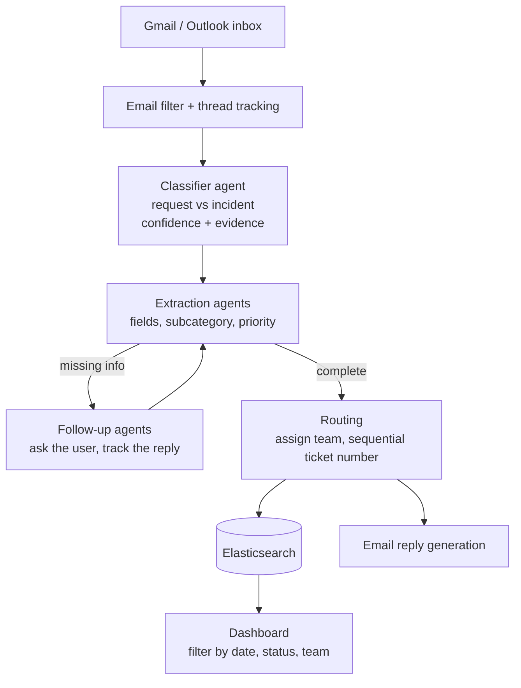

# Helpdesk multi-agent system: architecture

Built during my AI engineering internship. It turns an incoming support mailbox into structured, routed tickets. The code is public: [HelpDesk_Multi_Agent_System](https://github.com/AmineBenz0/HelpDesk_Multi_Agent_System).

## Flow

## Ideas worth noting

- **One agent per job.** Classification, extraction, follow-up and reply each have their own agent and state, so each can be tested and changed on its own.
- **Stateful workflow** (LangGraph): every ticket moves through explicit processing stages with clear handoffs between agents.
- **Confidence scores and extracted evidence** accompany each classification.
- **Follow-ups are first-class.** When a required field is missing the system asks for it and picks the conversation back up when the user answers, using email threads to link replies to tickets.
- **Ticket numbers** are sequential and Elasticsearch-based.
- **RAG for priority.** Domain-specific rules are retrieved and applied during priority assessment.
- **Benchmark before choosing a model.** I built a framework that compared open-source and hosted LLMs on task quality, latency, resource usage and function-calling performance. The results moved the working proof of concept from smaller local models to stronger hosted ones.
- **Enterprise plumbing.** OAuth2 email integrations, Dockerised services, monitoring dashboards and legacy-system constraints, with error handling, tests and traceability around the LLM steps.

## Stack

Python · LangGraph · RAG · Elasticsearch · Gmail / Outlook APIs (OAuth2) · Docker · Streamlit
