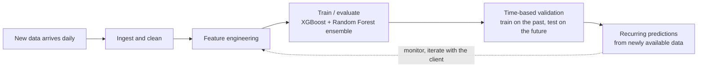
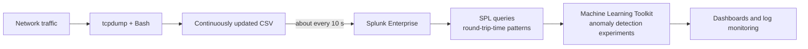

# Machine learning and data projects

Before I moved to agentic AI I built classic ML systems. They are why I care about evaluation: how you validate a model decides whether its numbers mean anything. Client details are left out; the methods and metrics are mine.

| Project | When | Headline result |
|---|---|---|
| [Automated prediction pipeline](#1-automated-prediction-pipeline-freelance) | 2024-25, freelance | 86.3% accuracy, 0.954 AUC with time-based validation |
| [Incident resolution-time model](#2-incident-resolution-time-model-dxc) | Summer 2024, DXC | Random Forest, MSE 1.69, R² 0.54 |
| [Network anomaly detection with Splunk](#3-network-anomaly-detection-htbs) | Summer 2023, HTBS | Strong anomaly surfaced in a controlled brute-force test |

---

## 1. Automated prediction pipeline (freelance)

Client work in gaming, sports analytics and sales forecasting. The main project was a pipeline that refreshes its data daily and produces new predictions from whatever data has arrived.

- **Result:** 86.3% accuracy and 0.954 AUC.
- **Why time-based validation:** random splits can let information from the future leak into training and inflate the score. Splitting by time reduces that leakage risk and mirrors how the model is used.
- **Beyond the model:** turning loosely defined client needs into a technical problem, iterating on results, and maintaining the system after the first training run.

## 2. Incident resolution-time model (DXC)

Goal: predict how long an IT incident will take to resolve, using operational ServiceNow data.

- **Data work first.** Cleaning and preprocessing, missing values and outliers, exploratory analysis. The target itself was engineered: resolution time derived from the opening and resolution timestamps.
- **Model comparison.** Linear Regression, Random Forest and SVR compared with 5-fold cross-validation. Random Forest won, and tuning with `RandomizedSearchCV` gave **MSE 1.69 and R² 0.54**.
- **What I took from it:** with messy operational data, data quality, feature design and domain assumptions shape the result before the algorithm does.

## 3. Network anomaly detection (HTBS)

A cybersecurity monitoring proof of concept combining network analysis, Splunk and machine learning.

- **Pipeline:** near-real-time ingestion built from Bash and `tcpdump`, converting packet data into a CSV that Splunk read about every 10 seconds.
- **Detection:** Round Trip Time patterns monitored with SPL and the Machine Learning Toolkit. During a controlled brute-force test the proof of concept surfaced a strong anomaly.
- **Scope:** a proof of concept and my first hands-on mix of machine learning, security and real-time data, not a production system.

---

**Stack across these projects:** Python · XGBoost · Random Forest · scikit-learn · SVR / Linear Regression baselines · cross-validation · `RandomizedSearchCV` · Splunk (SPL, MLTK) · Bash · tcpdump
