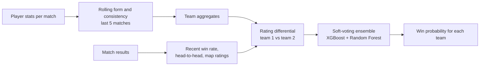
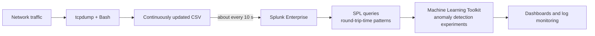

# Machine learning and data projects

Before I moved to agentic AI I built classic ML systems. They are why I care about evaluation: how you validate a model decides whether its numbers mean anything. Client details are left out; the methods and metrics are mine.

| Project | When | Headline result |
|---|---|---|
| [CS:GO match predictor](#1-csgo-match-outcome-predictor-freelance) | 2024-25, freelance | 86.3% accuracy, 0.954 AUC on a chronological test split |
| [Incident resolution-time model](#2-incident-resolution-time-model-dxc) | Summer 2024, DXC | Random Forest, MSE 1.69, R² 0.54 |
| [Network anomaly detection with Splunk](#3-network-anomaly-detection-htbs) | Summer 2023, HTBS | Strong anomaly surfaced in a controlled brute-force test |

---

## 1. CS:GO match outcome predictor (freelance)

A model that predicts the winner of professional Counter-Strike matches from player and team history. The data is refreshed daily and predictions are regenerated as new matches arrive. I also wrote it up as a short paper.

- **Features:** rolling 5-match rating and its spread per player, aggregated to the team; map-specific ratings; recent win rate; head-to-head record, down-weighted so a small sample cannot dominate; and the rating gap between the two teams.
- **Model:** XGBoost and Random Forest averaged by soft voting, with XGBoost tuned by grid search.
- **Result:** 86.3% accuracy and 0.954 AUC on a chronological test split. The most influential features were team average ratings, the rating gap, rankings, recent win rates and map-specific ratings.
- **Probabilities, not only winners:** in the example matches the output ranges from about 50/50 to roughly 98% for clear favourites.
- **Evaluation:** matches are split by date, so the model trains on earlier matches and is tested on later ones.
- **Limits I wrote down:** roster changes, team morale and tournament stakes, game-version shifts and missing tournament context are not modelled.
- **Beyond the model:** turning a loosely defined client need into a technical problem, iterating on results, and maintaining the system after the first training run.

## 2. Incident resolution-time model (DXC)

Goal: predict how long an IT incident will take to resolve, using operational ServiceNow data.

- **Data work first.** Cleaning and preprocessing, missing values and outliers, exploratory analysis. The target itself was engineered: resolution time derived from the opening and resolution timestamps.
- **Model comparison.** Linear Regression, Random Forest and SVR compared with 5-fold cross-validation. Random Forest won, and tuning with `RandomizedSearchCV` gave **MSE 1.69 and R² 0.54**.
- **What I took from it:** with messy operational data, data quality, feature design and domain assumptions shape the result before the algorithm does.

## 3. Network anomaly detection (HTBS)

A cybersecurity monitoring proof of concept combining network analysis, Splunk and machine learning.

- **Pipeline:** near-real-time ingestion built from Bash and `tcpdump`, converting packet data into a CSV that Splunk read about every 10 seconds.
- **Detection:** Round Trip Time patterns monitored with SPL and the Machine Learning Toolkit. During a controlled brute-force test the proof of concept surfaced a strong anomaly.
- **Scope:** a proof of concept and my first hands-on mix of machine learning, security and real-time data, not a production system.

---

**Stack across these projects:** Python · XGBoost · Random Forest · scikit-learn · SVR / Linear Regression baselines · cross-validation · `RandomizedSearchCV` · Splunk (SPL, MLTK) · Bash · tcpdump
