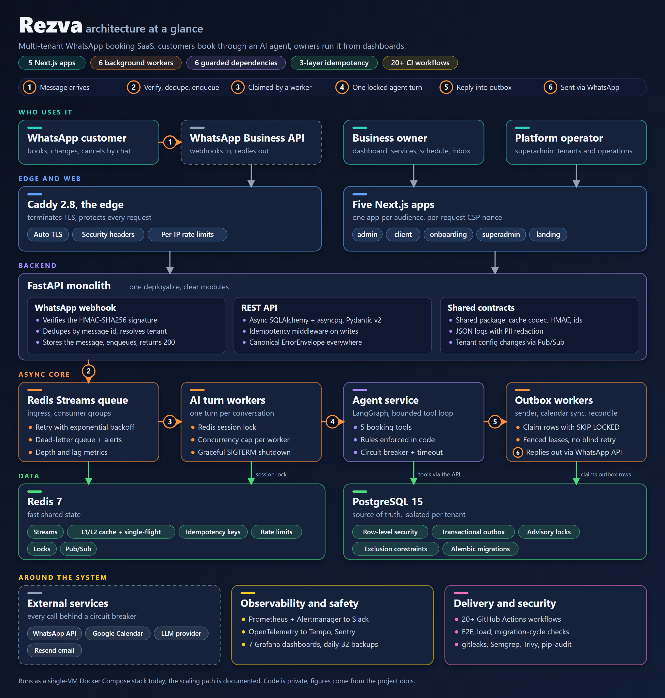
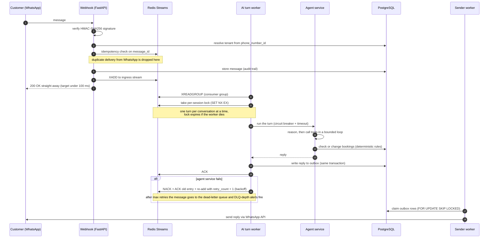
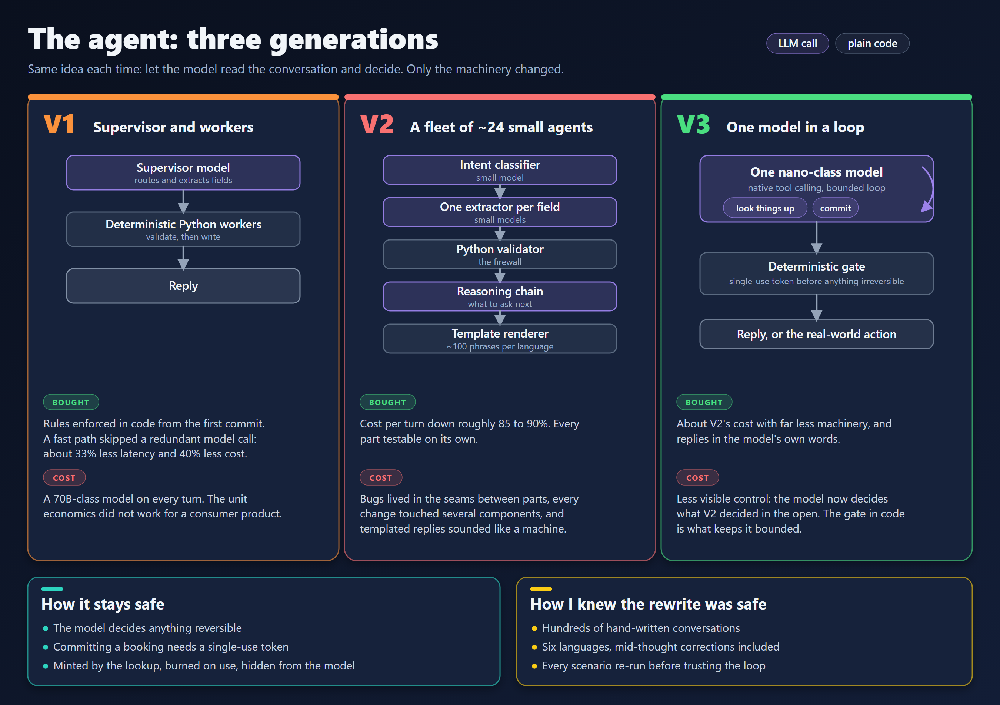
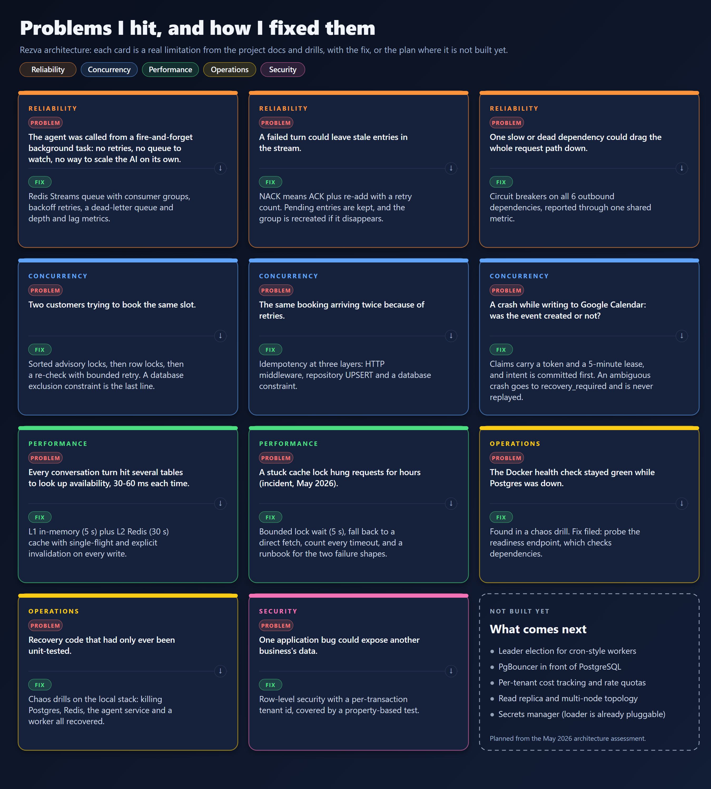
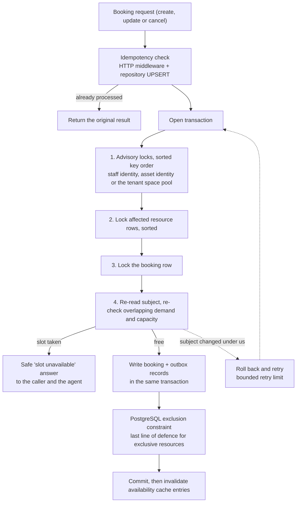
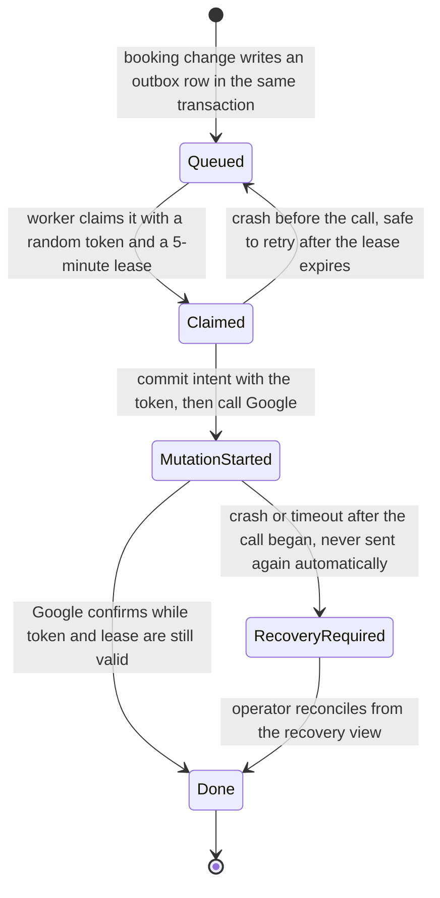

# Rezva: architecture

A multi-tenant SaaS that lets a business take, change and cancel bookings over **WhatsApp** through a conversational AI agent. The owner runs everything from web dashboards. Pre-launch; the code is private.

This page shows the system, the design patterns in it, and, most usefully, **the limitations I hit and how I fixed them**. Facts come from the project's own architecture docs, runbooks and chaos drill notes. Anything not yet built is labelled as such.

**Contents:** [System map](#1-system-map) · [One message, end to end](#2-one-message-end-to-end) · [The agent](#3-the-agent-three-generations) · [Limitations and fixes](#4-limitations-and-how-i-fixed-them) · [Booking writes](#5-booking-writes-two-people-one-slot) · [Calendar sync](#6-calendar-sync-surviving-a-crash-mid-request) · [Patterns and tech](#7-patterns-and-technologies) · [Known limits](#8-known-limits-and-what-comes-next) · [Proof it recovers](#9-proof-it-recovers)

---

## 1. System map

Today it runs as a single-VM Docker Compose stack: right-sized for the first customers, with the scaling path written down (see [section 8](#8-known-limits-and-what-comes-next)).

*Click the image for full size. Numbers 1 to 6 follow one customer message through the system.*

---

## 2. One message, end to end

The webhook does the minimum and returns. All the slow, failure-prone work happens behind a queue.

---

## 3. The agent: three generations

The agent was rebuilt twice. The full story is in my article, **[The Multi-Agent System That Wanted to Be a Monolith](https://medium.com/@amine.benzaarit0/the-multi-agent-system-that-wanted-to-be-a-monolith-bbc76c8541dc)** (Medium, June 2026). In one picture:

The idea underneath never changed: let the model read the conversation and decide, with a wall of code around anything that cannot be undone. The tools to express it cleanly only arrived at V3.

---

## 4. Limitations and how I fixed them

Every row is something that was actually wrong, slow or risky, with the fix that shipped (or the plan, where it has not shipped yet).

| Limitation | Why it hurt | Fix |
|---|---|---|
| Agent called through a fire-and-forget HTTP background task | No retries, no queue depth to watch, AI could not scale apart from the web process | Redis Streams ingress queue, consumer groups, backoff retries, DLQ, queue-depth and lag metrics |
| Failed turns and stream bookkeeping | A NACK could leave stale entries | NACK implemented as ACK + re-add with an incremented retry count (stream length capped); pending-entry retention; recovery when the consumer group is missing |
| Concurrent bookings for the same slot | Double booking | Advisory locks in sorted key order, then row locks, then re-read and re-check demand; bounded retries; a PostgreSQL exclusion constraint protects exclusive resources |
| Client or WhatsApp retries | Duplicate bookings | Idempotency keys enforced in HTTP middleware, in the repository UPSERT and in the database |
| Crash during a Google Calendar write | Unknown whether the event exists; blind retry could duplicate it | Outbox rows are claimed with a random token and a 5-minute lease; "mutation started" is committed before the call; a crash after that point is never replayed, it moves to `recovery_required` for an operator |
| Heavy availability reads | 30-60 ms of DB work per lookup, repeated as the agent browses dates | Two-level cache with single-flight and explicit invalidation (create, cancel, reschedule, schedule, vacation, blocked time); a bypass-rate alert catches a degraded cache |
| Cache lock deadlock (incident F8) | Requests hung for hours after a crashed task kept a lock | Lock acquire timeout with direct-fetch fallback, timeout counter, runbook with the two failure shapes (spike vs stuck) |
| Liveness vs readiness | Health check passed while the database was unreachable | Chaos drill exposed it; the fix is to probe the readiness endpoint (filed as a one-line change) |
| Cross-tenant risk | One bug could expose another business's rows | Row-level security, `SET LOCAL app.tenant_id` per transaction, property test |

---

## 5. Booking writes: two people, one slot

Sorting every lock acquisition is what prevents deadlocks between two requests that touch the same staff, asset or space pool in different orders.

---

## 6. Calendar sync: surviving a crash mid-request

Google Calendar is an external system I cannot roll back, so the worker records its intent before acting and never replays an action whose outcome is unknown.

---

## 7. Patterns and technologies

| Pattern | Where it is used | Technology |
|---|---|---|
| Queue-based load levelling, competing consumers | WhatsApp ingress to AI workers | Redis Streams, consumer groups |
| Dead-letter queue, retry with exponential backoff | Failed agent turns | Redis Streams, DLQ-depth alerts |
| Transactional outbox | WhatsApp replies, calendar writes | PostgreSQL, `SKIP LOCKED` claims |
| Fencing token + lease | Calendar worker claims | PostgreSQL |
| Idempotency keys (three layers) | Webhooks and booking writes | FastAPI middleware, UPSERT, DB constraints |
| Circuit breaker | All 6 outbound dependencies, agent calls | Unified Prometheus metric |
| Cache-aside with single-flight | Availability reads | In-memory L1 + Redis L2 |
| Distributed lock | One agent turn per conversation | Redis `SET NX EX` |
| Advisory locking in a fixed order | Booking writes | PostgreSQL |
| Row-level security multi-tenancy | Every tenant table | PostgreSQL 15, property test |
| Bounded agent loop with deterministic tools | Booking agent | One model in a tool loop, rules in code |
| Canonical error envelope, shared wire formats | API and agent service | Pydantic v2, `shared` package |
| Config invalidation fan-out | Tenant config changes | Redis Pub/Sub |

**Stack:** Python · FastAPI · async SQLAlchemy + asyncpg · Pydantic v2 · Alembic · PostgreSQL 15 · Redis 7 · Next.js (5 apps) · Caddy · Docker Compose · GitHub Actions (20+ workflows, including E2E, load, migration-cycle check, pip-audit, gitleaks, Semgrep, Trivy) · Prometheus · AlertManager · Grafana · OpenTelemetry + Tempo · Sentry · Backblaze B2 · Resend.

---

## 8. Known limits and what comes next

Written down on purpose: an architecture assessment (May 2026) lists what stops scaling and when it starts to matter. Items below are **planned, not built** unless stated.

| Limit today | Becomes a problem at | Planned fix |
|---|---|---|
| Single VM, vertical scaling only, no high availability | Roughly 50+ customers | Multi-node topology, read replica for dashboards and analytics |
| Cron-style workers run as a single replica; two replicas would double-fire them | First scale-out (5-10 customers) | Leader election with a PostgreSQL advisory lock per worker and tick |
| Direct connections to PostgreSQL: 4 processes x pool of up to 60 could exceed the 100-connection default | 5-10 customers | PgBouncer in transaction mode, smaller per-process pools, disable prepared-statement cache |
| No per-tenant cost tracking (LLM tokens are only global) | Pricing tiers, abuse detection | `cost_events` table fed by every LLM call, booking and WhatsApp send |
| Per-tenant rate quotas wired to only a few endpoints (noisy neighbour risk) | 5-10 customers | Tenant-scoped limits on the agent router and webhook ingress, cost-weighted |
| Secrets in `.env` files with tight permissions | First compliance request | The loader is already pluggable, so moving to a secrets manager is a config change |

---

## 9. Proof it recovers

Recovery primitives are only worth something if they fire under real failure. I ran chaos drills on the local stack (2026-05-27):

| Scenario | What happened |
|---|---|
| Postgres killed for 10 s | Readiness probe degraded correctly, webhook failed fast, backend ready again 11 s after restart, no corruption, no duplicates. Also exposed the health-check gap above. |
| Redis killed for 18 s | Streams and consumer group survived (AOF), next webhook answered in 61 ms, no duplicate booking, no lockout |
| Agent service killed for 22 s | Webhook still acknowledged in under 100 ms; worker did not crash, NACKed and retried; queue depth rose and drained after recovery |
| Worker killed mid-claim | Stale claim recovered by another pass |

All four executed scenarios passed. Network partition, full disk and the multi-replica scenarios are written but still need a staging environment.

---

*Earlier prototype: Rezva grew from a single-business barbershop calendar assistant (Streamlit, FastAPI, an LLM, MCP servers, Google Calendar). This is the multi-tenant rebuild.*
